# 모아 스탬프 (Moa Stamp)

카페 스탬프 · 쿠폰 · 멤버십 앱을 Flutter로 만든 포트폴리오 샘플입니다.
기획, 디자인, 개발을 처음부터 직접 했고 Android · iOS · Web을 하나의 코드로 지원합니다.

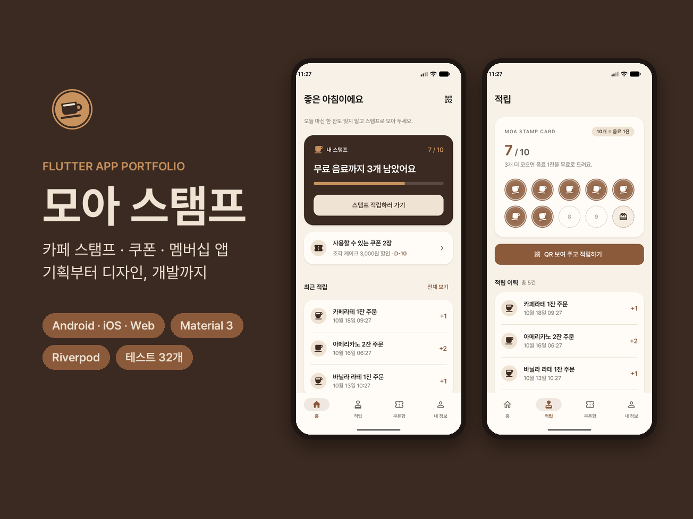

> 실제 브랜드나 매장과는 관계없는 가상의 서비스입니다. 계정과 기록은 서버로 보내지 않고 기기 안에만 저장합니다.

## 주요 기능

- **스탬프 적립**: 멤버십 QR을 보여 주면 도장이 찍힙니다. 칸마다 기울기가 다른 도장이 "쿵" 찍히는 애니메이션이 있고, 10개를 채우면 무료 음료 쿠폰이 자동으로 발급됩니다.
- **쿠폰함**: 사용 가능 · 사용 완료 · 만료 탭과 티켓 모양 쿠폰, 쿠폰 상세의 Code128 바코드, 확인 후 사용 처리를 제공합니다.
- **멤버십 QR**: 회원마다 8자리 회원 번호가 들어간 QR을 만들어 줍니다.
- **로그인 · 회원가입**: 입력값 검사, 약관 동의(전체 · 필수 · 선택), 비밀번호 보기 · 숨기기, 로그아웃과 회원 탈퇴를 지원합니다. 탈퇴하면 기록도 함께 지워집니다.
- **계정별 데이터**: 계정마다 스탬프와 쿠폰을 따로 저장합니다. 새로 가입하면 가입 축하 쿠폰을 받습니다.
- **온보딩 · 스플래시**: 처음 실행할 때만 앱 소개 3장을 보여 줍니다.
- **내 정보**: 회원 등급(새싹 → 단골 → 열혈 단골), 이용 통계, 샘플 데이터 되돌리기를 볼 수 있습니다.

## 데모 계정

로그인 화면에서 **"데모 계정으로 둘러보기"** 를 누르면 가입하지 않고도 예시 기록(스탬프 7개, 쿠폰 4장)으로 앱을 둘러볼 수 있습니다.

| 이메일 | 비밀번호 |
|---|---|
| `demo@moastamp.app` | `moastamp1234` |

## 스크린샷

| 온보딩 | 로그인 | 회원가입 | 홈 |
|:---:|:---:|:---:|:---:|
| 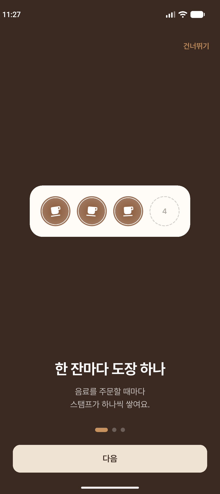 | 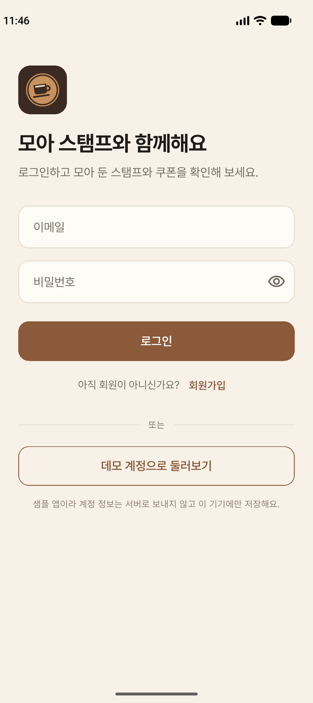 | 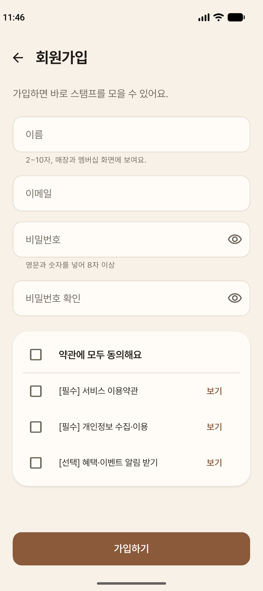 | 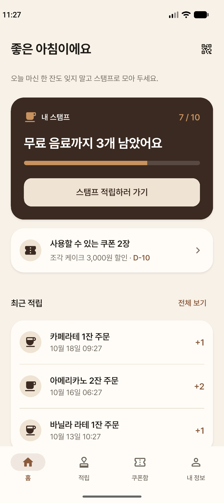 |

| 적립 | 멤버십 QR | 쿠폰 발급 | 쿠폰함 |
|:---:|:---:|:---:|:---:|
| 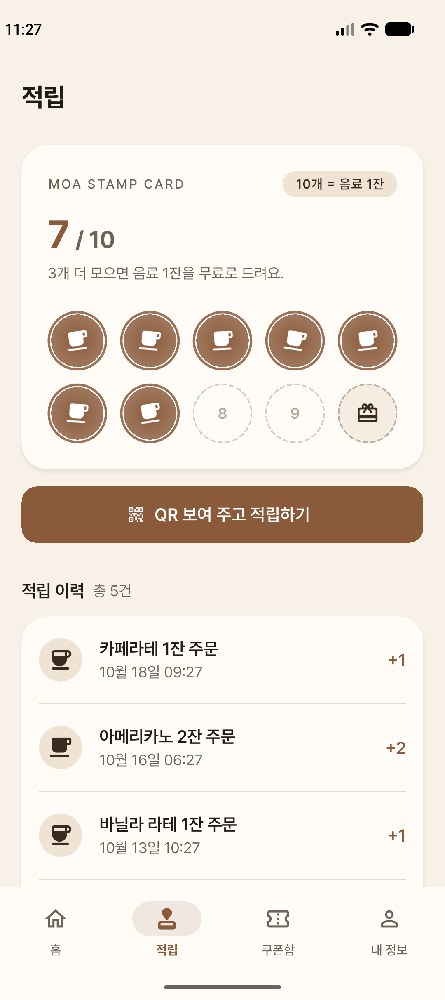 | 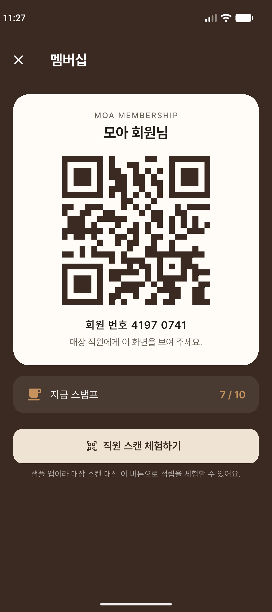 | 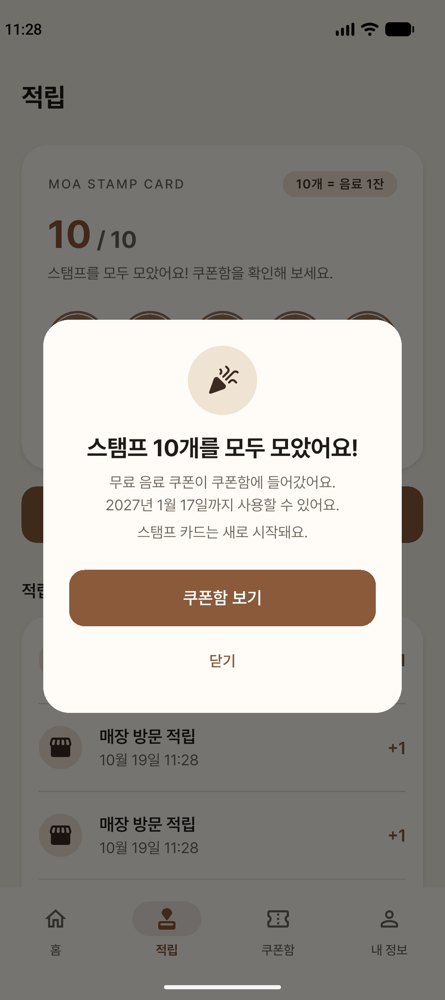 | 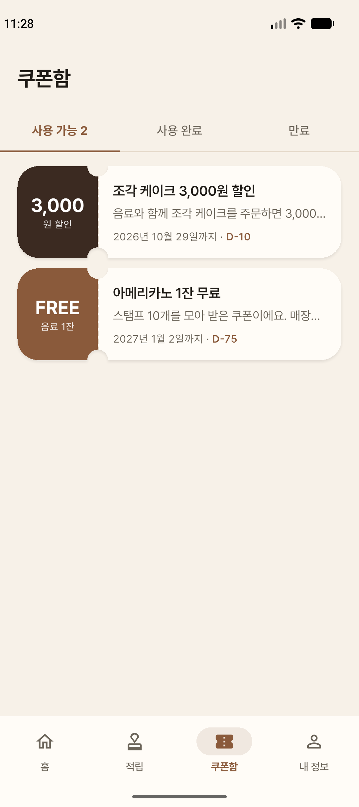 |

| 쿠폰 상세 | 내 정보 |
|:---:|:---:|
| 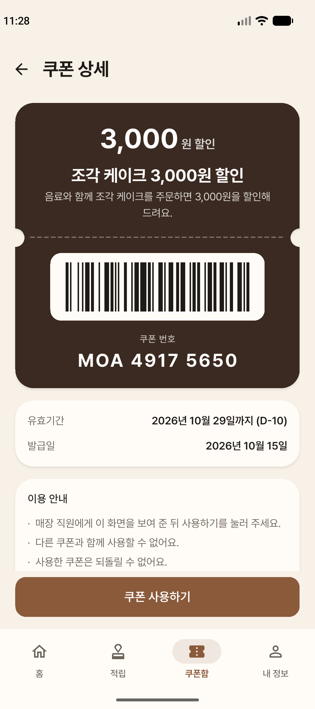 | 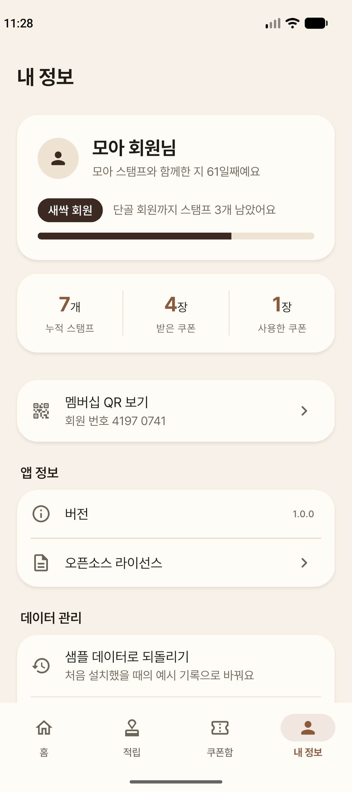 |

시연 영상(스탬프 적립부터 쿠폰 발급까지): [`marketing/demo_stamp_flow.mp4`](marketing/demo_stamp_flow.mp4)

## 기술 스택

| 구분 | 사용 기술 |
|---|---|
| Framework | Flutter 3.44 · Dart 3.12 · Material 3 |
| State management | `flutter_riverpod` (Notifier) |
| Routing | `go_router` (`StatefulShellRoute` 탭 4개, redirect로 온보딩 → 로그인 → 앱 순서 제어) |
| Storage | `shared_preferences` (계정별 key로 분리) |
| Auth | `AuthRepository` interface + `LocalAuthRepository` (salt + SHA-256, `crypto`) |
| UI | `qr_flutter`, `barcode_widget`, `intl` (날짜 형식) |
| Branding | `flutter_launcher_icons`, `flutter_native_splash`, Pretendard 번들 폰트 |
| Test | `flutter_test` (unit test · widget test 44개) |

### 설계 포인트

- **인증 교체가 쉬운 구조**: 화면과 상태는 `AuthRepository` interface에만 의존합니다. Firebase Auth 같은 서버 인증으로 바꿀 때는 `authRepositoryProvider`만 교체하면 됩니다.
- **규칙은 화면 밖에**: 적립 규칙(10개 → 쿠폰 발급 → 0개로 리셋), 연타 방지, 쿠폰 중복 사용 방지는 Notifier에서 처리하고 test로 검증합니다.
- **Design token**: 색, 간격, 모서리, 모션을 `lib/core/theme/`에 모아 두었습니다. 팔레트를 바꾸면 앱 전체에 반영됩니다.
- **한국어 가독성**: 단어 중간에서 줄이 바뀌지 않게 하는 `keepAll` extension을 쓰고, 날짜는 "10월 16일 14:30" 형식으로 표시합니다.

## 프로젝트 구조

```
lib/
├─ main.dart, app.dart
├─ core/
│  ├─ theme/        # AppColors, AppSpacing, AppTheme (Material 3)
│  ├─ router/       # go_router 설정, 온보딩·로그인 redirect
│  ├─ format/       # 날짜 형식, keepAll
│  └─ validation/   # 입력값 검사
├─ data/
│  ├─ models/       # Account, StampCard, StampRecord, Coupon
│  ├─ mock/         # 데모 계정 예시 기록
│  ├─ repositories/ # Auth · Stamp · Coupon repository, provider
│  └─ state/        # AuthNotifier, StampNotifier, CouponNotifier, 통계
├─ features/
│  ├─ onboarding/  auth/  home/  stamp/  membership/  coupons/  profile/
└─ widgets/         # 탭 shell, 공통 page, 티켓 모양, 적립 이력 목록

test/               # unit · widget test
tool/               # 아이콘·홍보 이미지 생성 script (Python, Pillow)
marketing/          # 홍보 이미지, 스크린샷, 시연 영상
```

## 실행 방법

```bash
flutter pub get
flutter run                 # 연결된 기기 또는 에뮬레이터
flutter run -d chrome       # 웹으로 실행
```

검사와 테스트:

```bash
flutter analyze
flutter test
```

아이콘과 홍보 이미지를 다시 만들 때 (Python, Pillow 필요):

```bash
python tool/make_icon.py
dart run flutter_launcher_icons
dart run flutter_native_splash:create
python tool/make_promo.py
```

## 디자인

다크 로스트 팔레트: 모든 색을 커피 계열 안에서만 씁니다.

| 역할 | 색 |
|---|---|
| Espresso | `#3B2A21` |
| Mocha (primary) | `#8A5A3B` |
| Caramel (point) | `#C8925E` |
| Latte | `#EFE3D3` |
| Background | `#F7F1E8` |

## 참고

- 이 앱은 포트폴리오용 샘플이며 실제 결제나 매장 시스템과 연결되어 있지 않습니다.
- 로컬 인증은 데모용입니다. 실제 서비스에서는 서버 인증을 사용해야 합니다.
- 폰트: [Pretendard](https://github.com/orioncactus/pretendard) (SIL Open Font License 1.1). 라이선스 전문은 `assets/fonts/pretendard/OFL.txt`에 있고, 앱의 "오픈소스 라이선스" 화면에서도 볼 수 있습니다.
